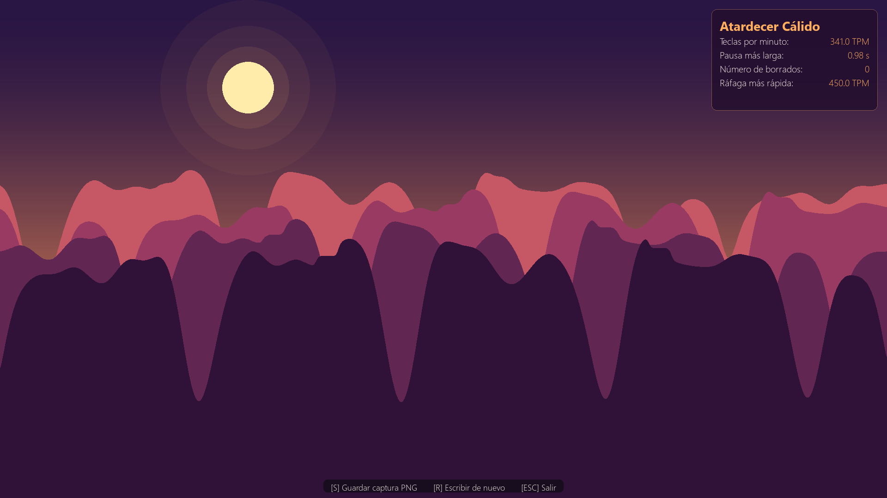
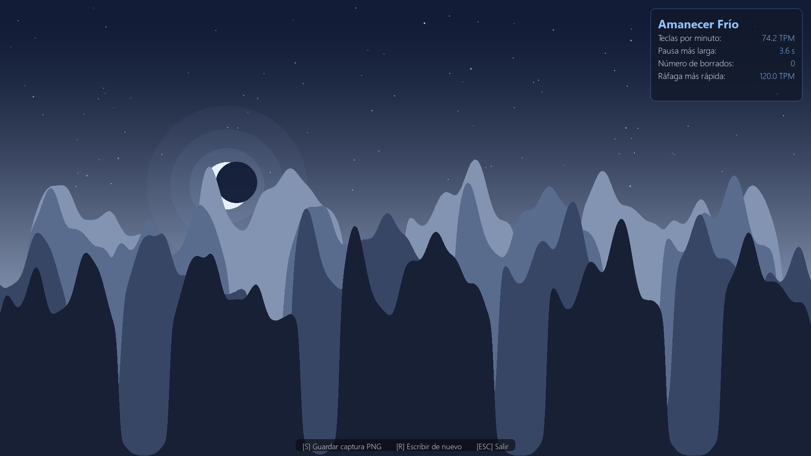
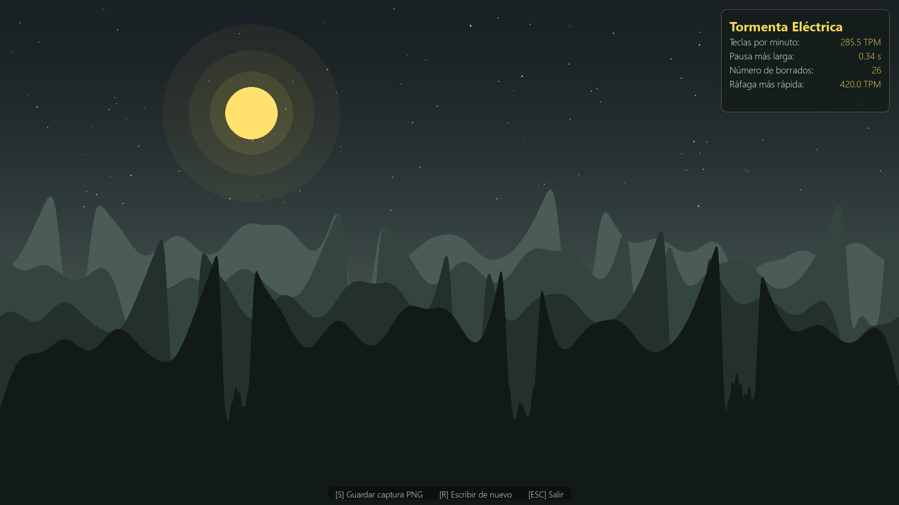

# Paisaje de tecleo

> Una aplicación de escritorio que transforma el ritmo y la cadencia de tu escritura libre en una ilustración vectorial de cordilleras montañosas única e irrepetible.



---

## Galería de Estilos

| Atardecer Cálido (Ritmo fluido y constante) | Amanecer Frío (Pausado y reflexivo) | Tormenta Eléctrica (Muchos borrados) |
| :---: | :---: | :---: |
|  |  |  |

---

## Requisitos e Instalación

El proyecto requiere **Python 3.11** o superior.

1. Clona o descarga este repositorio en tu equipo.
2. Instala las dependencias necesarias mediante `pip`:

```bash
pip install -r requirements.txt
```

Las dependencias principales son:
- `pygame-ce`: para la interfaz gráfica, captura de eventos de teclado y renderizado a 60 FPS.
- `numpy`: para el procesamiento de series temporales, convolución gaussiana y normalización de curvas.

---

## Cómo ejecutar

### Modo normal (sesión interactiva)
Inicia la aplicación y presiona cualquier tecla para comenzar a escribir durante 45 segundos:

```bash
python main.py
```

### Modo demostración (--demo)
Permite visualizar de inmediato paisajes generados con datos sintéticos sin necesidad de teclear:

```bash
python main.py --demo
```

También puedes especificar el estilo de ritmo inicial para la demostración:

```bash
python main.py --demo --estilo rapido      # Atardecer Cálido
python main.py --demo --estilo lento       # Amanecer Frío
python main.py --demo --estilo borrados    # Tormenta Eléctrica
```

> **Consejo:** Dentro del modo demo, puedes pulsar `[1]`, `[2]` o `[3]` para alternar al instante entre los 3 estilos.

---

## Controles de la aplicación

| Pantalla | Tecla | Acción |
| :--- | :--- | :--- |
| **Inicio** | Cualquier tecla | Iniciar la sesión de escritura |
| | `[Esc]` | Salir del programa |
| **Escritura** | Teclado | Escribir libremente en el editor |
| | `[Enter] × 2` | Terminar la sesión anticipadamente |
| | `[Esc]` | Concluir la sesión y generar el paisaje |
| **Resultado** | `[S]` | Guardar captura en alta resolución (1920×1080) en `capturas/` |
| | `[R]` | Iniciar una nueva sesión de escritura |
| | `[Esc]` | Salir de la aplicación |
| | `[1]`, `[2]`, `[3]` | *(Solo en modo demo)* Cambiar entre perfiles de tecleo |

---

## Cómo ajustar el paisaje

El archivo [`paisaje.py`](paisaje.py) contiene las constantes principales que determinan cómo se transforma la dinámica de escritura en formas geográficas. Puedes ajustarlas para personalizar la sensibilidad y el dramatismo visual:

- `VENTANA_VELOCIDAD_SEG`: Anchura temporal de la ventana para calcular la densidad de pulsaciones. Valores más bajos acentúan las fluctuaciones inmediatas; valores más altos producen cumbres más suaves y prolongadas.
- `UMBRAL_PAUSA_SEG`: Tiempo mínimo (en segundos) entre pulsaciones para considerarlo una interrupción del flujo. Cualquier pausa superior a este valor excava un valle en la cordillera.
- `FACTOR_PROFUNDIDAD_VALLE`: Controla qué tan profundo se hunde el terreno en función del tiempo de pausa.
- `ANCHO_GRIETA_RATIO`: Anchura de las muescas provocadas por pulsar la tecla de borrado (*Backspace*).
- `PROFUNDIDAD_GRIETA`: Profundidad de la hendidura vertical producida por cada borrado en la cresta frontal.
- `ANCHO_MESETA_RATIO`: Longitud de la meseta plana generada por un salto de línea (*Enter*).
- `SIGMA_SUAVIZADO`: Desviación estándar del filtro gaussiano 1D que otorga el acabado orgánico a la silueta.
- `ALTURA_MAXIMA_RATIO`: Proporción de la altura de la ventana que ocupa la cumbre más alta (por defecto `0.52`, cercano al 55% de la ventana).
- `CONFIG_CAPAS`: Lista de parámetros para cada una de las 4 siluetas montañosas (de fondo a frente), definiendo altura relativa, línea de base vertical, nivel de suavizado y desplazamiento horizontal para otorgar profundidad y perspectiva.
